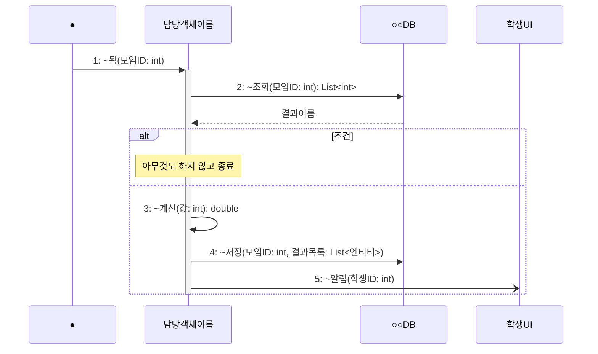

# seq-XX 기능명

## 참여 객체

| 객체 | 종류 | 클래스 파일 |
|---|---|---|
| 담당객체이름 | 담당 객체 | classes/XXX.md |
| 공통객체이름 | 공통 객체 | classes/XXX.md |
| ○○DB | DB | classes/XXX.md |
| 학생UI | UI | classes/StudentUI.md |

## 다이어그램

시작 방식에 맞는 첫 줄 하나만 남긴다.

## 메시지 ↔ Action 대응표

| 메시지 | Action |
|---|---|
| 1~2 | 1 |
| 3 | 2 |

## 작성 전 체크

- [ ] 객체 이름이 GLOSSARY 표기와 같다 (공백·약어 없음)
- [ ] 시작 메시지가 규칙(5.2)에 맞다
- [ ] 메시지 이름 끝말이 규칙(5.3)에 맞다
- [ ] 모든 매개변수가 `이름: 자료형`이고 자료형이 허용 목록에 있다
- [ ] Action의 if-else가 alt/opt로, 반복이 loop로 표현됐다
- [ ] 대응표를 썼다
- [ ] 받는 클래스 파일에 연산을 반영했다
